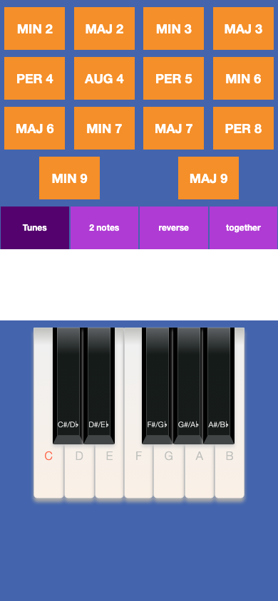
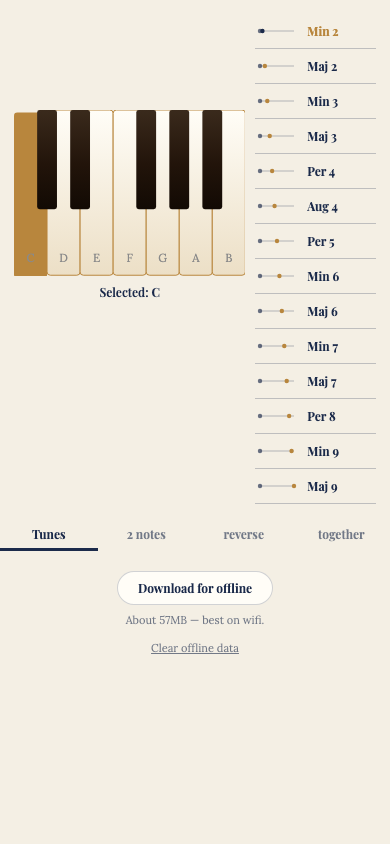

# Then vs. now: rewriting Interval App

Interval App began as an Apache Cordova hybrid app hosted on GitLab, and was rewritten, from that same codebase, audio and interval catalogue, as a React + TypeScript PWA. This page compares the two.

The legacy app's own Backbone.js dependency is version 1.2.3, released in 2015 — over a decade separates the two screenshots below, even though it's the same product underneath.

## Side by side

| Legacy (Cordova/Backbone) | Current (React/TypeScript) |
|---|---|
|  |  |

The current app is live at https://intervalapp.gilbert-lee-tech.workers.dev. There was also a step in between: the first React release, which had the original navy theme and was later restyled into the "Classic conservatory" look shown above. It's still live at https://intervalapplegacy.gilbert-lee-tech.workers.dev.

## Technology & frameworks

| | Legacy | Current |
|---|---|---|
| Language | ES5 JavaScript, no modules | TypeScript |
| UI framework | Backbone.js 1.2.3 (views + a thin `Backbone.Events` mixin for a home-grown pub/sub) | React 19 (function components + hooks) |
| Templating | Handlebars 4.0.5 (inline template strings) | JSX |
| DOM/utility libs | jQuery 2.2.1, Underscore.js | none — React handles the DOM, no lodash/underscore equivalent needed |
| Native shell | Apache Cordova (`cordova.js`, `config.xml`, Android/iOS platforms) | none — a PWA running directly in the browser |
| Dependency management | none — all four libraries vendored as committed `<script>` files | npm, `package.json`/`package-lock.json` |
| Build step | none — files loaded directly via `<script>` tags in `index.html` | Vite 8 (bundling, TypeScript compilation, asset hashing) |

## Tooling & dev experience

The legacy app has no test suite, no linter, and no build step to catch mistakes before they ship — a broken asset path only shows up by clicking around in a browser. The current app adds:

- **`oxlint`** over all of `src/`.
- **`scripts/check-assets.ts`**, run automatically as a `prebuild` step — it verifies that every `(interval, mode, note)` combination actually resolves to a real audio/SVG file under `public/`, and fails the build if one doesn't.
- **TypeScript** end to end, including a separately-typechecked service worker (`tsconfig.sw.json`).
- **Vite's dev server**, with instant hot-reload, replacing "edit a file, reload the page."

## Deployment

- **Legacy**: static files hosted manually on a regular web host — no CI/CD, no visible build pipeline; presumably uploaded by hand.
- **Current**: Cloudflare Workers static assets, deployed via Cloudflare's Workers Builds GitHub integration — every push and PR triggers an automatic build and deploy, with separate live deployments for production, a development preview, and a frozen snapshot of the first React release, all built from the same repo.

## Progressive Web App (PWA)

- **Legacy**: no PWA capability at all — no web app manifest, no service worker. The only way to get it onto a phone as something resembling an app is Cordova's native packaging: building an actual Android/iOS binary and distributing it through an app store (or side-loading it), a whole separate toolchain from "the website."
- **Current**: a real, installable PWA via `vite-plugin-pwa`. A web app manifest (`name`, `theme_color`/`background_color` matching the app's own parchment palette, `display: "standalone"` so it opens without browser chrome like a native app, and a full icon set including a maskable variant for adaptive icons) makes "Add to Home Screen" work on a phone in one tap — no app store, no binary, no review process. `public/install.html` is a student-facing guide for that install flow. The app shell (JS/CSS/HTML/icons) is precached on install by the service worker (Workbox, via `vite-plugin-pwa`'s `injectManifest` mode), so the app itself loads instantly even offline; see below for how the audio/SVG library itself is handled.

## Offline & caching

- **Legacy**: the legacy app is just a plain website with no offline support at all. Every single click fetches its MP3 over the network fresh, with no caching whatsoever — so there's a real, repeated delay before each clip starts, even for a note you just played seconds ago.
- **Current**: offline playback via a hand-written service worker (`src/sw.ts`) using Workbox `CacheFirst` routes, including byte-range request support so `<audio>` seeking still works offline. Once a clip has played once, every repeat play of it is instant, served straight from the cache. There's also an explicit "Download for offline" control that pre-fetches the entire ~57MB audio/SVG library up front, so there's no per-click download delay at all, even the first time.

## Code size

- **Legacy**: ~766 lines of hand-written ES5 (`mainController.js` 382, `startingNoteView.js` 140, `playTuneNoteView.js` 106, `intervalView.js` 69, `IntervalModel.js` 20, `baseController.js` 20, `index.js` 29) — plus roughly 10,000+ lines of vendored library code committed straight into the repo (jQuery alone is checked in *twice*: once at `www/js/jquery-2.2.1.min.js` and again at `www/js/frameworks/jquery-2.2.1.js`).
- **Current**: ~915 lines of TypeScript across `src/` — a bit more than the legacy app's own code, but for real added functionality (offline support, keyboard-accessible piano keys, etc.) — with zero vendored library code and exactly two runtime dependencies (`react`, `react-dom`).

## One more thing

The legacy Cordova app's `config.xml` still has `id="io.cordova.hellocordova"` — the literal default from the Cordova "Hello World" template, never customized in however many years the app has been live.

---

The source code and the audio/sheet-music assets are kept in a private repository. See the [README](README.md) for the live links.
