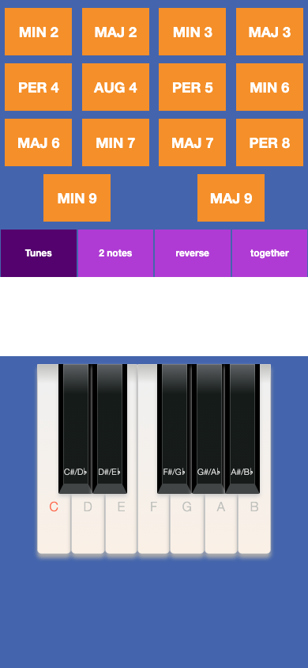
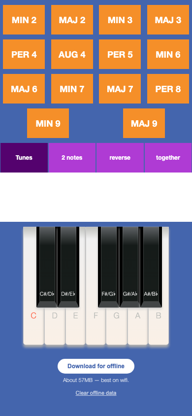
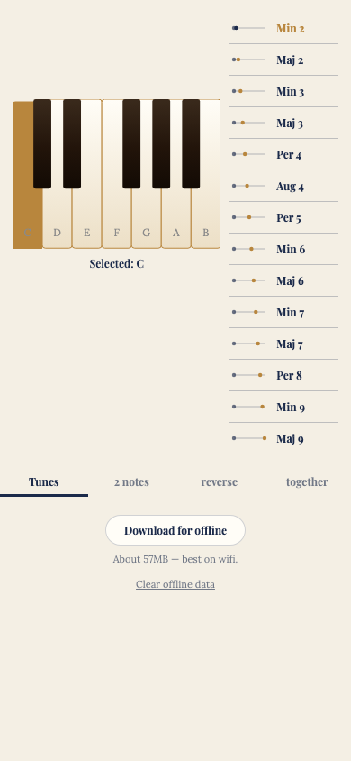

# Interval App

An ear-training app for musical intervals, built for piano students preparing for music-theory exams. Pick a starting note and an interval, and the app plays it as a real melody built around that interval, as two separate notes, reversed, or together, with the matching sheet music on screen.

It's a Progressive Web App: it installs to a phone's home screen in one tap (no app store) and works offline.

**Try it:** https://intervalapp.gilbert-lee-tech.workers.dev

## From Cordova to React

| Original (Cordova/Backbone) | First React release | Current ("Classic conservatory") |
|---|---|---|
|  |  |  |

The app started as an Apache Cordova hybrid app using Backbone.js, jQuery and Handlebars, all from around 2015. It was rewritten from scratch as a React + TypeScript PWA:

1. **First React release**: a faithful port of the original look, adding offline support and a one-tap "Download for offline" option. It's still live at https://intervalapplegacy.gilbert-lee-tech.workers.dev.
2. **Current**: a full visual redesign (parchment, navy and brass, with serif type and an ivory/ebony piano), plus accessibility and interaction improvements.

Along the way, the rewrite fixed a long-standing bug from the original: in melody mode, the minor and major 9th intervals showed the sheet music for a different song.

**[Read the full then-vs-now comparison →](COMPARISON.md)**

## Built with Claude Code

I did this rewrite with Claude Code, Anthropic's AI coding tool, as my pair programmer: 7 days from first commit to the current version, 35 pull requests that I reviewed and merged, and 63 of 65 commits co-authored with Claude.

**[See how I worked, with the full PR timeline →](AI-WORKFLOW.md)**

## Tech stack

React 19, TypeScript and Vite. The PWA uses a hand-written Workbox service worker, which caches the audio and sheet music on demand or pre-fetches the whole ~57MB library. It's a static site with no backend, hosted on Cloudflare Workers and deployed automatically from GitHub.

## About this repository

This is a showcase only. The source code and the audio/sheet-music assets are kept in a private repository.
